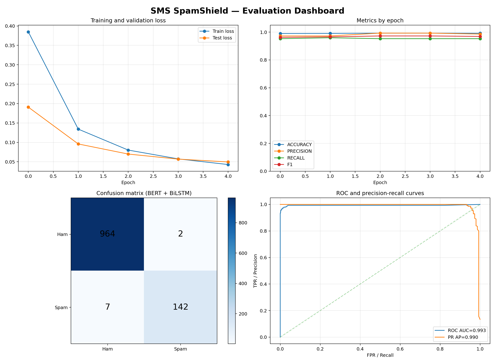

# 🛡️ SMS SpamShield

### Intelligent SMS Threat Detection with BERT, BiLSTM and Explainable ML

> **A hackathon-ready NLP security project by Yash Bhure**

SMS SpamShield detects whether a message is legitimate (**HAM**) or malicious (**SPAM**) using contextual language understanding, deep sequence modeling, and explainable machine learning.

It is designed for a live demo: train it, inspect the complete scorecard, open the generated visual dashboard, and classify a suspicious message interactively.



## ✨ Why this project?

Spam messages are not just annoying—they can carry phishing links, financial fraud, impersonation attempts, and social-engineering attacks. SpamShield converts raw SMS text into a security decision with confidence scoring and measurable evidence.

### Highlights

- 🧠 **BERT + BiLSTM classifier** for contextual text understanding.
- ⚡ **Fast CPU model** using TF-IDF + balanced Logistic Regression.
- 🌳 **Explainable Decision Tree baseline** for transparent decisions.
- 📊 Complete metrics: accuracy, precision, recall, F1, ROC-AUC, average precision and specificity.
- 🔎 Confusion matrix with false-positive and false-negative analysis.
- 📈 Training-loss, metric, ROC and precision-recall visualizations.
- 💬 Single-message and interactive prediction modes.
- 🚀 Ready for deployment as a Hugging Face Gradio Space.

## 🧩 System architecture


```text
SMS message
    │
    ▼
Tokenizer / TF-IDF vectorizer
    │
    ├── BERT contextual embeddings ──► BiLSTM ──► Classifier ──► HAM / SPAM
    │
    ├── TF-IDF ──► Logistic Regression ──► Fast CPU prediction
    │
    └── TF-IDF ──► Decision Tree ──► Explainable baseline
```

## 🏆 Results

The test set contains **1,115 messages**, with stratified sampling preserving the original class distribution.

| Model | Accuracy | Precision | Recall | F1 | ROC-AUC | Specificity |
|---|---:|---:|---:|---:|---:|---:|
| **BERT + BiLSTM** | **99.19%** | **98.61%** | **95.30%** | **96.93%** | **99.31%** | **99.79%** |
| Fast CPU Logistic Regression | 98.83% | 97.89% | 93.29% | 95.53% | 99.02% | 99.69% |
| Decision Tree | 95.52% | 82.78% | 83.89% | 83.33% | 88.06% | 97.31% |

### BERT + BiLSTM error analysis

```text
True negatives: 964
False positives: 2
False negatives: 7
True positives: 142
```

The model achieved only **2 false positives** and **7 missed spam messages** on the test split.

## 📊 Visual reports

| Report | Preview |
|---|---|
| Evaluation dashboard | [Open dashboard](reports/evaluation_dashboard.png) |
| Decision tree | [Open tree](reports/decision_tree.png) |
| Fast CPU dashboard | [Open CPU dashboard](reports/fast_cpu_dashboard.png) |
| Model comparison | [Open CSV](reports/model_comparison.csv) |

The `reports/` directory also contains JSON metrics, per-class classification reports, and model artifacts.

> The 422 MB `bert_bilstm_weights.pt` checkpoint is intentionally excluded from GitHub because GitHub limits individual files to 100 MB. Upload that checkpoint to the Hugging Face Space or Model Hub separately.

## 🚀 Run locally

### 1. Install dependencies

```powershell
python -m venv .venv
.venv\Scripts\activate
pip install -r requirements.txt
```

### 2. Fast CPU training

Recommended for laptops and hackathon demonstrations:

```powershell
python fast_cpu.py
```

This produces results quickly without BERT backpropagation.

### 3. Full BERT + BiLSTM training

```powershell
python main.py --epochs 5 --verbose 2
```

Verbosity options:

```text
--verbose 0   Quiet training
--verbose 1   Full metrics per epoch
--verbose 2   One compact line per epoch
```

For CPU-only machines, full BERT fine-tuning can take hours. A CUDA-enabled PyTorch installation is strongly recommended for this mode.

### 4. Classify a message

```powershell
python main.py --message "Congratulations! You won a free prize. Call now!"
```

Or launch interactive mode:

```powershell
python main.py --interactive
```

## 🧪 Example decisions

| Input | Expected decision |
|---|---|
| `Congratulations! You have won a free prize. Call now!` | 🚨 SPAM |
| `Hey, are we still meeting for lunch today?` | ✅ HAM |

## 🤗 Hugging Face deployment

The repository includes `app.py`, a Gradio inference interface.

1. Train the model first:

   ```powershell
   python main.py --epochs 5 --verbose 2
   ```

2. Confirm this file exists:

   ```text
   reports/bert_bilstm_weights.pt
   ```

3. Create a new **Gradio Space** on Hugging Face.
4. Upload:

   ```text
   app.py
   model.py
   requirements.txt
   reports/bert_bilstm_weights.pt
   ```

5. Or upload from the terminal:

   ```powershell
   hf auth login
   hf upload YOUR_USERNAME/sms-spamshield . --repo-type=space
   ```

The Space will install `requirements.txt` and launch `app.py` automatically. Keep tokens and private data out of the repository.

## 📁 Project structure

```text
SMS-spam-detection/
├── app.py                         # Hugging Face Gradio app
├── main.py                        # BERT + BiLSTM training pipeline
├── fast_cpu.py                    # Fast TF-IDF CPU pipeline
├── data.py                        # Dataset and tokenizer interface
├── model.py                       # BERT + BiLSTM architecture
├── spam.csv                       # SMS dataset
├── requirements.txt               # Python dependencies
└── reports/                       # Metrics, graphs and model artifacts
```

## 🔐 Security perspective

This project demonstrates classification, not a guarantee that every message is safe. Production systems should combine the model with URL reputation, sender history, rate limiting, user reporting, adversarial testing, and human review for high-impact decisions.

## 👤 Author

**Yash Bhure** — NLP, deep learning and cybersecurity project.

Hugging Face: [huggingface.co/Yashbhure](https://huggingface.co/yashbhure0009/sms-spam-bert-bilstm/)

---

### Built to detect threats before they become incidents. 🛡️
